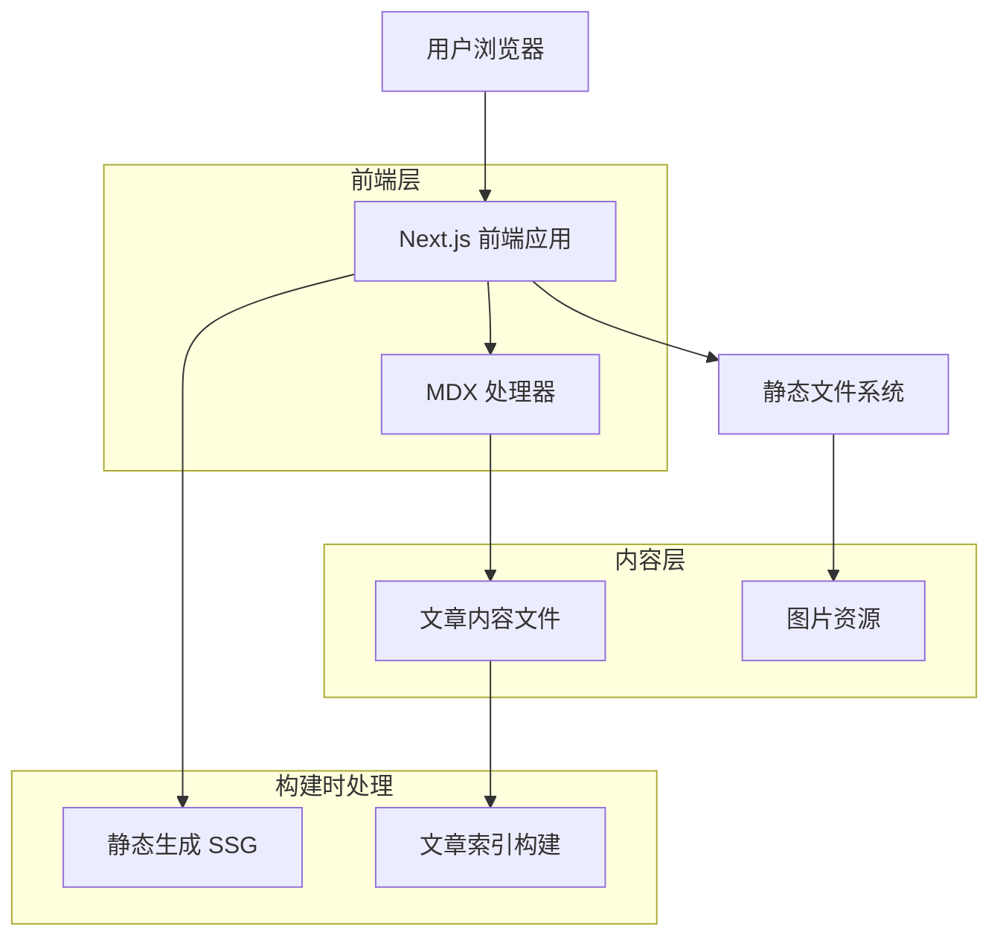
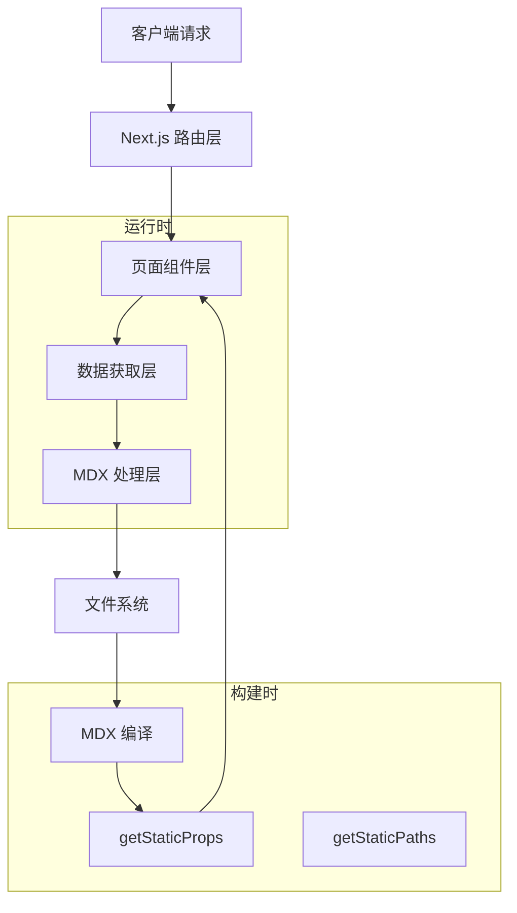

# 博客系统技术架构文档

## 1. 架构设计



## 2. 技术描述

* **前端**：Next.js\@14 + React\@18 + TypeScript + Tailwind CSS

* **内容处理**：@next/mdx + remark + rehype 插件生态

* **构建优化**：静态生成 (SSG) + 增量静态再生 (ISR)

* **样式系统**：Tailwind CSS + 现有 UI 组件库

* **图标库**：Lucide React

* **代码高亮**：Prism.js 或 Shiki

* **搜索功能**：客户端 Fuse.js 模糊搜索

## 3. 路由定义

| 路由                         | 用途               |
| -------------------------- | ---------------- |
| /blog                      | 博客列表页面，显示所有文章    |
| /blog/\[slug]              | 博客详情页面，显示具体文章内容  |
| /blog/category/\[category] | 分类页面，显示特定分类的文章   |
| /blog/search               | 搜索结果页面，显示搜索匹配的文章 |

## 4. API 定义

### 4.1 核心数据类型

```typescript
// 文章元数据接口
interface BlogPost {
  slug: string
  title: string
  description: string
  author: string
  publishedAt: string
  updatedAt?: string
  category: string
  tags: string[]
  readingTime: number
  viewCount: number
  featured: boolean
  coverImage?: string
}

// 文章内容接口
interface BlogPostContent extends BlogPost {
  content: string
  tableOfContents: TableOfContentsItem[]
}

// 目录项接口
interface TableOfContentsItem {
  id: string
  title: string
  level: number
  children?: TableOfContentsItem[]
}

// 分页数据接口
interface PaginatedPosts {
  posts: BlogPost[]
  totalPages: number
  currentPage: number
  totalPosts: number
}

// 搜索结果接口
interface SearchResult {
  posts: BlogPost[]
  query: string
  totalResults: number
}
```

### 4.2 静态生成函数

```typescript
// 获取所有文章列表
export async function getAllPosts(): Promise<BlogPost[]>

// 根据 slug 获取文章内容
export async function getPostBySlug(slug: string): Promise<BlogPostContent>

// 获取分页文章
export async function getPaginatedPosts(page: number, limit: number): Promise<PaginatedPosts>

// 根据分类获取文章
export async function getPostsByCategory(category: string): Promise<BlogPost[]>

// 获取相关文章推荐
export async function getRelatedPosts(slug: string, limit: number): Promise<BlogPost[]>

// 搜索文章
export async function searchPosts(query: string): Promise<SearchResult>

// 获取所有分类
export async function getAllCategories(): Promise<string[]>
```

## 5. 服务器架构图



## 6. 数据模型

### 6.1 文件系统结构

```
content/
├── blog/
│   ├── getting-started-with-ocr.mdx
│   ├── advanced-image-processing.mdx
│   ├── api-integration-guide.mdx
│   └── ...
├── images/
│   ├── blog/
│   │   ├── getting-started/
│   │   ├── advanced-processing/
│   │   └── ...
└── data/
    ├── authors.json
    └── categories.json
```

### 6.2 MDX 文件格式

```mdx
---
title: "OCR 技术入门指南"
description: "详细介绍 OCR 技术的基本原理和应用场景"
author: "技术团队"
publishedAt: "2024-01-15"
category: "技术教程"
tags: ["OCR", "图像处理", "机器学习"]
featured: true
coverImage: "/images/blog/ocr-guide/cover.jpg"
---

# OCR 技术入门指南

本文将详细介绍 OCR（光学字符识别）技术的基本原理...

## 什么是 OCR

OCR 是一种将图像中的文字转换为可编辑文本的技术...
```

### 6.3 配置文件

Next.js MDX 配置 (next.config.js):

```javascript
const withMDX = require('@next/mdx')({
  extension: /\.mdx?$/,
  options: {
    remarkPlugins: [
      require('remark-gfm'),
      require('remark-reading-time'),
    ],
    rehypePlugins: [
      require('rehype-slug'),
      require('rehype-autolink-headings'),
      require('rehype-prism-plus'),
    ],
  },
})

module.exports = withMDX({
  pageExtensions: ['ts', 'tsx', 'js', 'jsx', 'md', 'mdx'],
  experimental: {
    mdxRs: true,
  },
})
```

### 6.4 组件架构

```
components/
├── blog/
│   ├── BlogCard.tsx          # 文章卡片组件
│   ├── BlogList.tsx          # 文章列表组件
│   ├── BlogSearch.tsx        # 搜索组件
│   ├── CategoryFilter.tsx    # 分类筛选组件
│   ├── Pagination.tsx        # 分页组件
│   ├── TableOfContents.tsx   # 目录导航组件
│   ├── RelatedPosts.tsx      # 相关推荐组件
│   └── MDXComponents.tsx     # MDX 自定义组件
├── layout/
│   ├── BlogLayout.tsx        # 博客页面布局
│   └── PostLayout.tsx        # 文章详情布局
└── ui/
    ├── Badge.tsx             # 标签徽章
    ├── SearchInput.tsx       # 搜索输入框
    └── ReadingProgress.tsx   # 阅读进度条
```

### 6.5 性能优化策略

1. **静态生成 (SSG)**：所有博客页面在构建时预生成
2. **增量静态再生 (ISR)**：支持内容更新而无需重新构建
3. **图片优化**：使用 Next.js Image 组件自动优化
4. **代码分割**：按页面和组件自动分割代码
5. **缓存策略**：静态资源长期缓存，API 数据适当缓存
6. **懒加载**：非关键组件和图片懒加载
7. **搜索优化**：客户端搜索索引预构建，避免实时查询

### 6.6 SEO 优化

1. **元数据生成**：自动生成页面 title、description、keywords
2. **结构化数据**：添加 JSON-LD 结构化数据标记
3. **站点地图**：自动生成博客文章的 sitemap
4. **内部链接**：相关文章推荐增强内部链接结构
5. **社交分享**：Open Graph 和 Twitter Card 元数据

