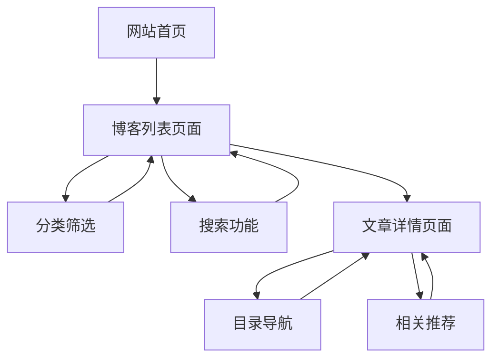

# 博客系统产品需求文档

## 1. 产品概述

基于 Next.js 和 MDX 技术栈开发的博客系统，为 ImageOCR Online 网站提供内容管理和展示功能。系统将与现有网站无缝集成，保持一致的设计风格和用户体验，通过静态生成优化性能。

- 主要目的：为网站添加博客功能，提供技术文章、产品更新、使用教程等内容展示
- 目标用户：网站访问者、技术爱好者、OCR 技术用户
- 核心价值：提升网站内容丰富度，增强用户粘性，改善 SEO 表现

## 2. 核心功能

### 2.1 用户角色

| 角色 | 访问方式 | 核心权限 |
|------|----------|----------|
| 访客用户 | 直接访问 | 可浏览博客列表、阅读文章、搜索内容 |
| 注册用户 | 登录后访问 | 除访客权限外，可收藏文章、评论互动 |

### 2.2 功能模块

博客系统包含以下核心页面：
1. **博客列表页面**：文章展示、分类筛选、搜索功能、分页导航
2. **博客详情页面**：文章内容展示、目录导航、相关推荐、互动功能

### 2.3 页面详情

| 页面名称 | 模块名称 | 功能描述 |
|----------|----------|----------|
| 博客列表页面 | 文章列表展示 | 显示文章标题、摘要、发布日期、分类标签，支持卡片式布局 |
| 博客列表页面 | 分类筛选器 | 提供分类标签筛选，支持多选和清空操作 |
| 博客列表页面 | 搜索功能 | 实时搜索文章标题和内容关键词，支持高亮显示 |
| 博客列表页面 | 分页导航 | 每页显示10篇文章，提供页码导航和上下页切换 |
| 博客详情页面 | 文章头部信息 | 显示文章标题、作者、发布日期、阅读量、分类标签 |
| 博客详情页面 | 文章内容渲染 | 支持 MDX 格式渲染，包含代码高亮、图片展示、表格等 |
| 博客详情页面 | 目录导航 | 自动生成文章目录，支持锚点跳转和当前位置高亮 |
| 博客详情页面 | 相关推荐 | 基于分类和标签推荐相关文章，显示3-4篇推荐内容 |

## 3. 核心流程

### 用户浏览流程
用户访问博客系统的主要操作流程：

1. 用户进入博客列表页面
2. 可选择分类筛选或使用搜索功能
3. 浏览文章列表，点击感兴趣的文章
4. 进入文章详情页面阅读完整内容
5. 通过目录导航快速定位内容
6. 查看相关推荐文章继续阅读

## 4. 用户界面设计

### 4.1 设计风格

- **主色调**：沿用网站现有的蓝色渐变主题 (#3B82F6 到 #6366F1)
- **辅助色**：灰色系 (#F8FAFC, #E2E8F0, #64748B)
- **按钮样式**：圆角按钮，支持主要和次要样式
- **字体**：Inter 字体，标题使用 font-bold，正文使用 font-normal
- **布局风格**：卡片式设计，响应式网格布局
- **图标风格**：使用 Lucide React 图标库，保持简洁现代

### 4.2 页面设计概览

| 页面名称 | 模块名称 | UI 元素 |
|----------|----------|---------|
| 博客列表页面 | 页面头部 | 渐变背景、页面标题、面包屑导航 |
| 博客列表页面 | 筛选工具栏 | 分类标签按钮、搜索输入框、清空筛选按钮 |
| 博客列表页面 | 文章卡片 | 白色卡片背景、阴影效果、悬停动画、标签徽章 |
| 博客列表页面 | 分页组件 | 页码按钮、上下页箭头、页面信息显示 |
| 博客详情页面 | 文章头部 | 大标题、作者信息、日期时间、阅读量图标 |
| 博客详情页面 | 内容区域 | MDX 渲染、代码高亮、图片优化、表格样式 |
| 博客详情页面 | 侧边栏 | 固定位置目录、进度指示器、返回顶部按钮 |
| 博客详情页面 | 推荐区域 | 相关文章卡片、缩略图、简短描述 |

### 4.3 响应式设计

- **桌面端**：1200px+ 三栏布局，侧边栏固定，内容区域居中
- **平板端**：768px-1199px 两栏布局，侧边栏可折叠
- **移动端**：<768px 单栏布局，目录导航改为下拉菜单
- **触摸优化**：按钮最小点击区域 44px，适配手指操作