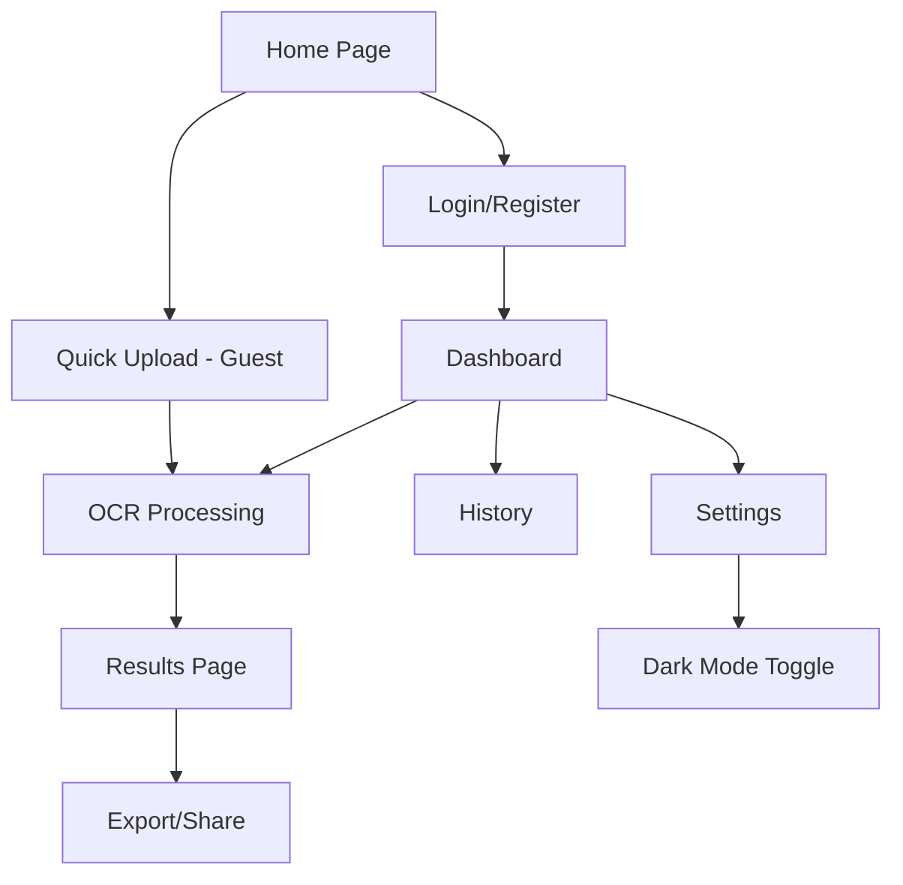

# OCR Online - Product Requirements Document

## 1. Product Overview
OCR Online is a web-based image text recognition platform that allows users to upload images and extract text content using advanced OCR technology. The platform provides secure user authentication, real-time text extraction, and seamless content management capabilities.

The product solves the problem of manual text transcription from images, serving students, professionals, and businesses who need to digitize printed or handwritten content quickly and accurately.

## 2. Core Features

### 2.1 User Roles
| Role | Registration Method | Core Permissions |
|------|---------------------|------------------|
| Guest User | No registration required | Can upload images and perform OCR with limited daily usage |
| Registered User | Email registration with verification | Unlimited OCR processing, history management, dark mode preferences |
| Premium User | Subscription upgrade | Advanced OCR features, batch processing, API access |

### 2.2 Feature Module
Our OCR platform consists of the following main pages:
1. **Home page**: hero section with OCR demo, feature highlights, user testimonials, and quick upload area.
2. **Authentication pages**: login and registration forms with social login options and email verification.
3. **OCR processing page**: image upload interface, real-time OCR processing, text preview and editing capabilities.
4. **Dashboard page**: user profile management, processing history, usage statistics, and settings.
5. **Results page**: detailed OCR results display, text formatting options, download and sharing features.

### 2.3 Page Details
| Page Name | Module Name | Feature description |
|-----------|-------------|---------------------|
| Home page | Hero section | Display main value proposition with interactive OCR demo and call-to-action buttons |
| Home page | Feature highlights | Showcase key features with icons and descriptions (accuracy, speed, security) |
| Home page | Quick upload | Allow immediate image upload for guest users with drag-and-drop functionality |
| Authentication | Login form | Email/password authentication with "Remember me" and "Forgot password" options |
| Authentication | Registration form | User signup with email verification, terms acceptance, and optional newsletter subscription |
| Authentication | Social login | Google and GitHub OAuth integration for quick registration |
| OCR processing | Image upload | Support multiple image formats (JPG, PNG, PDF) with preview and file validation |
| OCR processing | OCR engine | Real-time text extraction with progress indicator and confidence scoring |
| OCR processing | Text preview | Display extracted text with editing capabilities and formatting preservation |
| OCR processing | Copy functionality | One-click text copying with success notifications and clipboard integration |
| Dashboard | Profile management | User information editing, password change, and account deletion options |
| Dashboard | Processing history | List of previous OCR jobs with search, filter, and pagination |
| Dashboard | Usage statistics | Visual charts showing daily/monthly usage and accuracy metrics |
| Dashboard | Settings | Dark mode toggle, language preferences, and notification settings |
| Results | Text display | Formatted text output with syntax highlighting and line numbering |
| Results | Export options | Download as TXT, PDF, or DOCX with custom formatting |
| Results | Sharing features | Generate shareable links with expiration dates and access controls |

## 3. Core Process

**Guest User Flow:**
Guest users can immediately access the OCR functionality from the homepage. They upload an image through the quick upload area, which redirects them to the processing page where OCR analysis begins automatically. Results are displayed with basic editing and copying capabilities, but without saving or history features.

**Registered User Flow:**
Registered users log in through the authentication page and access their personalized dashboard. From there, they can start new OCR processing, view their history, or manage settings. The OCR process includes additional features like result saving, advanced editing, and export options. Users can toggle between light and dark modes based on their preferences.

**Premium User Flow:**
Premium users have access to all registered user features plus advanced capabilities like batch processing, API access, and priority processing queues.

## 4. User Interface Design

### 4.1 Design Style
- **Primary colors**: Blue (#2563eb) for primary actions, Gray (#64748b) for secondary elements
- **Secondary colors**: Green (#10b981) for success states, Red (#ef4444) for errors, Orange (#f59e0b) for warnings
- **Button style**: Rounded corners (8px radius) with subtle shadows and hover animations
- **Font**: Inter font family with 16px base size, 14px for secondary text, 24px+ for headings
- **Layout style**: Clean card-based design with consistent spacing (16px, 24px, 32px grid)
- **Icons**: Heroicons for consistency, with 20px and 24px standard sizes

### 4.2 Page Design Overview
| Page Name | Module Name | UI Elements |
|-----------|-------------|-------------|
| Home page | Hero section | Large heading with gradient text, animated background, prominent CTA button with blue primary color |
| Home page | Feature highlights | Three-column grid layout with icon cards, hover effects, and subtle animations |
| Home page | Quick upload | Dashed border drop zone with upload icon, file type indicators, and progress bars |
| Authentication | Login form | Centered card layout with input fields, social login buttons, and form validation styling |
| OCR processing | Image upload | Split-screen layout with image preview on left, upload controls on right, drag-and-drop styling |
| OCR processing | Text preview | Code editor-style interface with line numbers, syntax highlighting, and copy buttons |
| Dashboard | Navigation | Sidebar navigation with active states, user avatar, and collapsible menu items |
| Results | Text display | Full-width text area with toolbar, formatting options, and export button group |

### 4.3 Responsiveness
The platform is mobile-first responsive with breakpoints at 640px (mobile), 768px (tablet), and 1024px (desktop). Touch interactions are optimized for mobile devices with larger tap targets and swipe gestures for navigation.

## 5. Technical Specifications

### 5.1 SEO Requirements
- Dynamic meta titles and descriptions based on page content
- Open Graph tags for social media sharing
- Structured data markup for search engines
- Sitemap generation and robots.txt configuration
- Page loading optimization with Next.js Image component

### 5.2 Performance Requirements
- Page load time under 3 seconds on 3G networks
- OCR processing completion within 10 seconds for standard images
- 99.9% uptime availability
- Support for images up to 10MB in size

### 5.3 Security Requirements
- HTTPS encryption for all communications
- Secure file upload with virus scanning
- User data encryption at rest
- Rate limiting for API endpoints
- CSRF protection and input validation