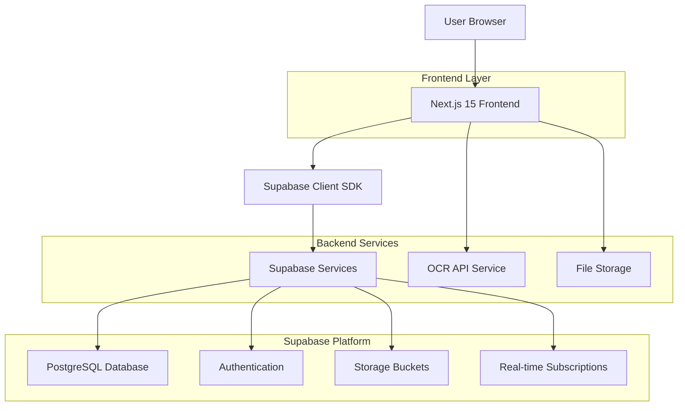
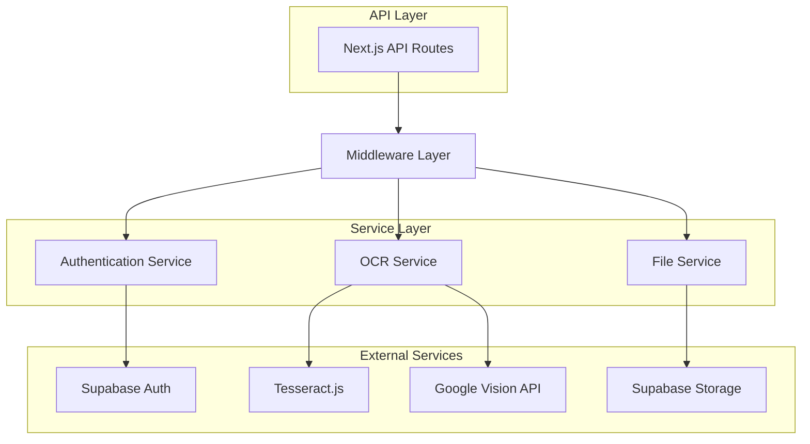
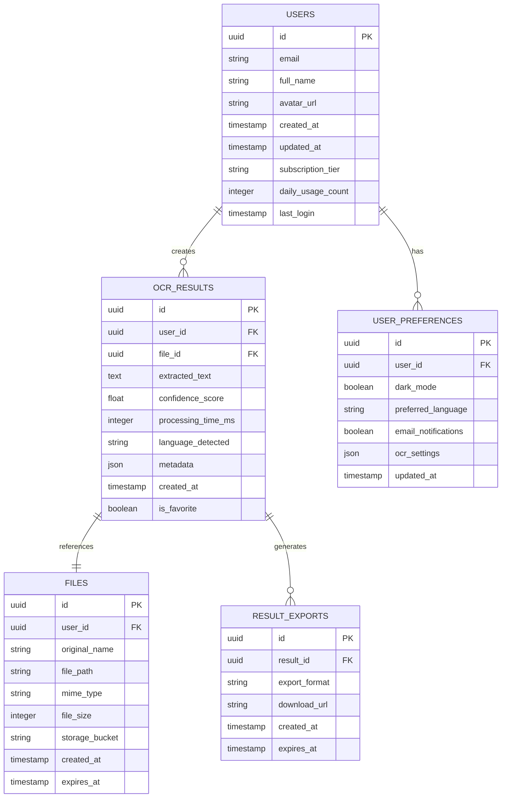

# OCR Online - Technical Architecture Document

## 1. Architecture Design



## 2. Technology Description

- **Frontend**: Next.js 15 + React 18 + TypeScript + Tailwind CSS + Framer Motion
- **Backend**: Supabase (PostgreSQL + Auth + Storage + Real-time)
- **OCR Service**: Tesseract.js (client-side) + Google Vision API (server-side)
- **File Storage**: Supabase Storage with CDN
- **Deployment**: Vercel (Frontend) + Supabase Cloud

## 3. Route Definitions

| Route | Purpose |
|-------|---------|
| / | Home page with hero section and quick OCR demo |
| /auth/login | User login page with email/password and social auth |
| /auth/register | User registration with email verification |
| /auth/forgot-password | Password reset functionality |
| /dashboard | User dashboard with history and settings |
| /ocr | Main OCR processing interface |
| /results/[id] | Individual OCR result display and management |
| /profile | User profile management and preferences |
| /api/ocr/process | Server-side OCR processing endpoint |
| /api/auth/callback | OAuth callback handling |

## 4. API Definitions

### 4.1 Core API

**OCR Processing**
```
POST /api/ocr/process
```

Request:
| Param Name | Param Type | isRequired | Description |
|------------|------------|------------|-------------|
| image | File | true | Image file (JPG, PNG, PDF) up to 10MB |
| language | string | false | OCR language code (default: 'eng') |
| options | object | false | OCR processing options |

Response:
| Param Name | Param Type | Description |
|------------|------------|-------------|
| success | boolean | Processing status |
| text | string | Extracted text content |
| confidence | number | OCR confidence score (0-100) |
| processingTime | number | Time taken in milliseconds |
| resultId | string | Unique result identifier |

Example Request:
```json
{
  "image": "<file_data>",
  "language": "eng",
  "options": {
    "preserveFormatting": true,
    "detectOrientation": true
  }
}
```

Example Response:
```json
{
  "success": true,
  "text": "Extracted text content here...",
  "confidence": 95.2,
  "processingTime": 3420,
  "resultId": "ocr_result_123456"
}
```

**User Management**
```
GET /api/user/profile
PUT /api/user/profile
GET /api/user/history
DELETE /api/user/results/[id]
```

**File Management**
```
POST /api/files/upload
GET /api/files/[id]
DELETE /api/files/[id]
```

## 5. Server Architecture Diagram



## 6. Data Model

### 6.1 Data Model Definition



### 6.2 Data Definition Language

**Users Table**
```sql
-- Create users table (extends Supabase auth.users)
CREATE TABLE public.users (
    id UUID REFERENCES auth.users(id) PRIMARY KEY,
    email VARCHAR(255) UNIQUE NOT NULL,
    full_name VARCHAR(100),
    avatar_url TEXT,
    created_at TIMESTAMP WITH TIME ZONE DEFAULT NOW(),
    updated_at TIMESTAMP WITH TIME ZONE DEFAULT NOW(),
    subscription_tier VARCHAR(20) DEFAULT 'free' CHECK (subscription_tier IN ('free', 'premium', 'enterprise')),
    daily_usage_count INTEGER DEFAULT 0,
    last_login TIMESTAMP WITH TIME ZONE
);

-- Enable RLS
ALTER TABLE public.users ENABLE ROW LEVEL SECURITY;

-- Create policies
CREATE POLICY "Users can view own profile" ON public.users
    FOR SELECT USING (auth.uid() = id);

CREATE POLICY "Users can update own profile" ON public.users
    FOR UPDATE USING (auth.uid() = id);

-- Grant permissions
GRANT SELECT ON public.users TO anon;
GRANT ALL PRIVILEGES ON public.users TO authenticated;
```

**User Preferences Table**
```sql
CREATE TABLE public.user_preferences (
    id UUID PRIMARY KEY DEFAULT gen_random_uuid(),
    user_id UUID REFERENCES public.users(id) ON DELETE CASCADE,
    dark_mode BOOLEAN DEFAULT false,
    preferred_language VARCHAR(10) DEFAULT 'en',
    email_notifications BOOLEAN DEFAULT true,
    ocr_settings JSONB DEFAULT '{}',
    updated_at TIMESTAMP WITH TIME ZONE DEFAULT NOW()
);

ALTER TABLE public.user_preferences ENABLE ROW LEVEL SECURITY;

CREATE POLICY "Users can manage own preferences" ON public.user_preferences
    FOR ALL USING (auth.uid() = user_id);

GRANT ALL PRIVILEGES ON public.user_preferences TO authenticated;
```

**OCR Results Table**
```sql
CREATE TABLE public.ocr_results (
    id UUID PRIMARY KEY DEFAULT gen_random_uuid(),
    user_id UUID REFERENCES public.users(id) ON DELETE CASCADE,
    file_id UUID REFERENCES public.files(id) ON DELETE CASCADE,
    extracted_text TEXT NOT NULL,
    confidence_score FLOAT CHECK (confidence_score >= 0 AND confidence_score <= 100),
    processing_time_ms INTEGER,
    language_detected VARCHAR(10),
    metadata JSONB DEFAULT '{}',
    created_at TIMESTAMP WITH TIME ZONE DEFAULT NOW(),
    is_favorite BOOLEAN DEFAULT false
);

ALTER TABLE public.ocr_results ENABLE ROW LEVEL SECURITY;

CREATE POLICY "Users can manage own OCR results" ON public.ocr_results
    FOR ALL USING (auth.uid() = user_id);

-- Create indexes
CREATE INDEX idx_ocr_results_user_id ON public.ocr_results(user_id);
CREATE INDEX idx_ocr_results_created_at ON public.ocr_results(created_at DESC);
CREATE INDEX idx_ocr_results_confidence ON public.ocr_results(confidence_score DESC);

GRANT ALL PRIVILEGES ON public.ocr_results TO authenticated;
```

**Files Table**
```sql
CREATE TABLE public.files (
    id UUID PRIMARY KEY DEFAULT gen_random_uuid(),
    user_id UUID REFERENCES public.users(id) ON DELETE CASCADE,
    original_name VARCHAR(255) NOT NULL,
    file_path TEXT NOT NULL,
    mime_type VARCHAR(100) NOT NULL,
    file_size INTEGER NOT NULL,
    storage_bucket VARCHAR(100) DEFAULT 'ocr-uploads',
    created_at TIMESTAMP WITH TIME ZONE DEFAULT NOW(),
    expires_at TIMESTAMP WITH TIME ZONE DEFAULT (NOW() + INTERVAL '30 days')
);

ALTER TABLE public.files ENABLE ROW LEVEL SECURITY;

CREATE POLICY "Users can manage own files" ON public.files
    FOR ALL USING (auth.uid() = user_id);

CREATE INDEX idx_files_user_id ON public.files(user_id);
CREATE INDEX idx_files_expires_at ON public.files(expires_at);

GRANT ALL PRIVILEGES ON public.files TO authenticated;
```

**Result Exports Table**
```sql
CREATE TABLE public.result_exports (
    id UUID PRIMARY KEY DEFAULT gen_random_uuid(),
    result_id UUID REFERENCES public.ocr_results(id) ON DELETE CASCADE,
    export_format VARCHAR(10) CHECK (export_format IN ('txt', 'pdf', 'docx', 'json')),
    download_url TEXT,
    created_at TIMESTAMP WITH TIME ZONE DEFAULT NOW(),
    expires_at TIMESTAMP WITH TIME ZONE DEFAULT (NOW() + INTERVAL '7 days')
);

ALTER TABLE public.result_exports ENABLE ROW LEVEL SECURITY;

CREATE POLICY "Users can access exports of own results" ON public.result_exports
    FOR SELECT USING (
        EXISTS (
            SELECT 1 FROM public.ocr_results 
            WHERE id = result_exports.result_id 
            AND user_id = auth.uid()
        )
    );

GRANT SELECT ON public.result_exports TO authenticated;
```

**Storage Buckets Setup**
```sql
-- Create storage bucket for OCR uploads
INSERT INTO storage.buckets (id, name, public)
VALUES ('ocr-uploads', 'ocr-uploads', false);

-- Create storage policies
CREATE POLICY "Users can upload own files" ON storage.objects
    FOR INSERT WITH CHECK (bucket_id = 'ocr-uploads' AND auth.uid()::text = (storage.foldername(name))[1]);

CREATE POLICY "Users can view own files" ON storage.objects
    FOR SELECT USING (bucket_id = 'ocr-uploads' AND auth.uid()::text = (storage.foldername(name))[1]);

CREATE POLICY "Users can delete own files" ON storage.objects
    FOR DELETE USING (bucket_id = 'ocr-uploads' AND auth.uid()::text = (storage.foldername(name))[1]);
```

**Initial Data**
```sql
-- Insert default user preferences for new users (via trigger)
CREATE OR REPLACE FUNCTION public.handle_new_user()
RETURNS TRIGGER AS $$
BEGIN
    INSERT INTO public.users (id, email, full_name, avatar_url)
    VALUES (NEW.id, NEW.email, NEW.raw_user_meta_data->>'full_name', NEW.raw_user_meta_data->>'avatar_url');
    
    INSERT INTO public.user_preferences (user_id)
    VALUES (NEW.id);
    
    RETURN NEW;
END;
$$ LANGUAGE plpgsql SECURITY DEFINER;

CREATE TRIGGER on_auth_user_created
    AFTER INSERT ON auth.users
    FOR EACH ROW EXECUTE FUNCTION public.handle_new_user();
```